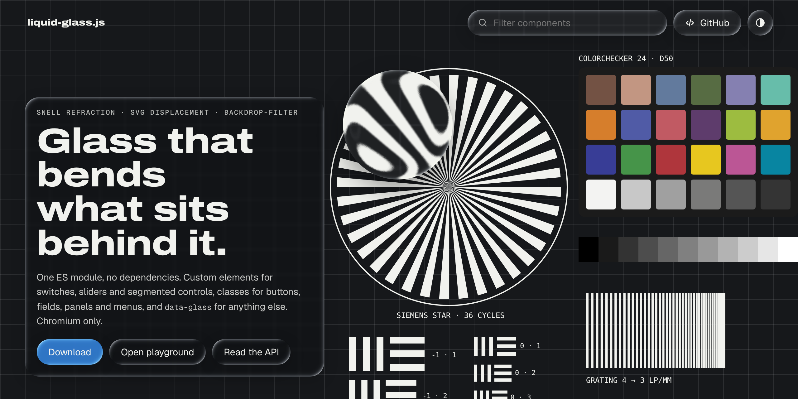

<p align="center"></p>

# liquid-glass.js

Apple-style Liquid Glass for the web: real refraction through SVG displacement maps used as `backdrop-filter`.
One ES module, no dependencies, latest Chromium only.

**Demo:** https://liquid-glass.naa.gg

## Use

```html
<script type="module" src="liquid-glass.min.js"></script>

<div data-glass style="border-radius: 24px">any element</div>
<button class="lg-btn" data-glass>Button</button>
<lg-switch name="wifi" checked></lg-switch>
<lg-slider name="volume" value="40"></lg-slider>
<lg-segmented data-glass><button>Day</button><button>Week</button></lg-segmented>
```

Tune any glass element with `--lg-*` custom properties (`profile`, `bezel`, `thickness`, `ior`, `refraction`, `blur`,
`saturation`, `specular`, `light`, `zoom`, `antialias`) or from JS with `glass(el, opts)` and `el.glass.update(opts)`.
The demo's API section lists every option and component.

## Develop

```sh
npm ci
npm run lint   # oxlint
npm test       # math self-check
npm run fmt    # oxfmt
npm run build  # oxc-minify → liquid-glass.min.js, stamps the download sizes into index.html
```

`liquid-glass.min.js` and the sizes in `index.html` are committed, so Cloudflare Pages serves the repo root without a
build step. CI fails if they are stale. To open the demo locally, serve the folder over HTTP (`npx serve`): ES modules
don't load from `file://`.

## Credits

Based on [Liquid Glass in the Browser: Refraction with CSS and SVG](https://kube.io/blog/liquid-glass-css-svg/) on
kube.io. The refraction model, the displacement-map encoding and the filter chain come from that article.
